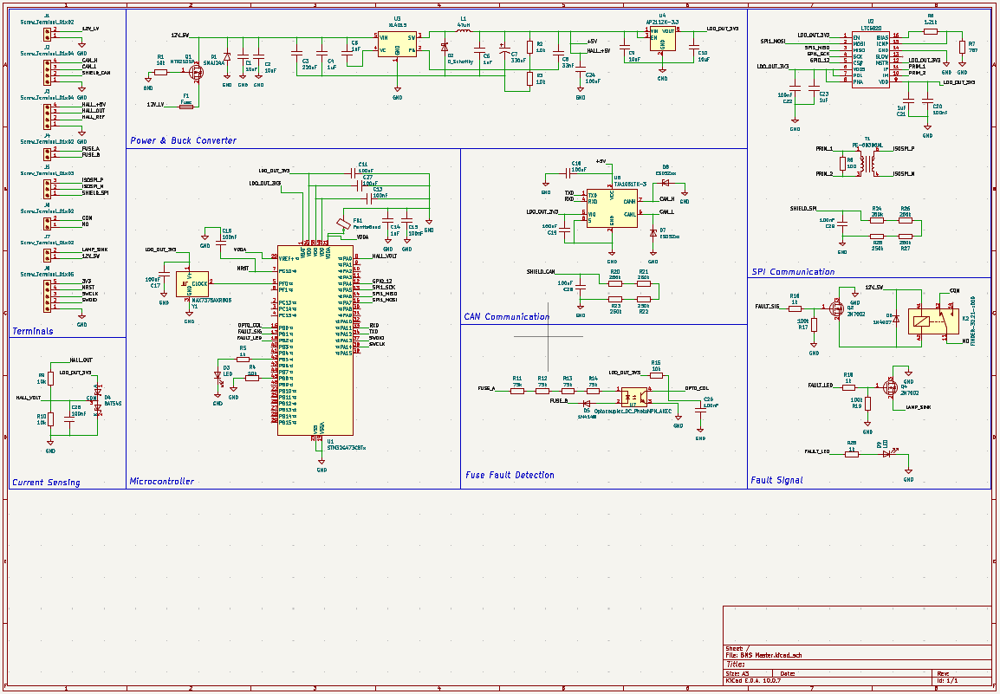
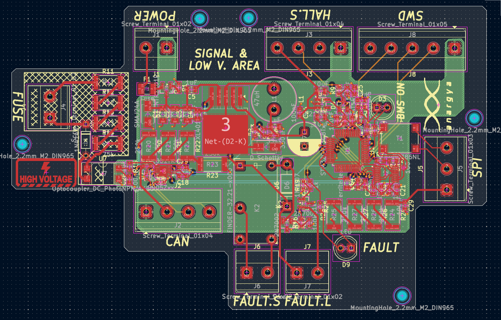
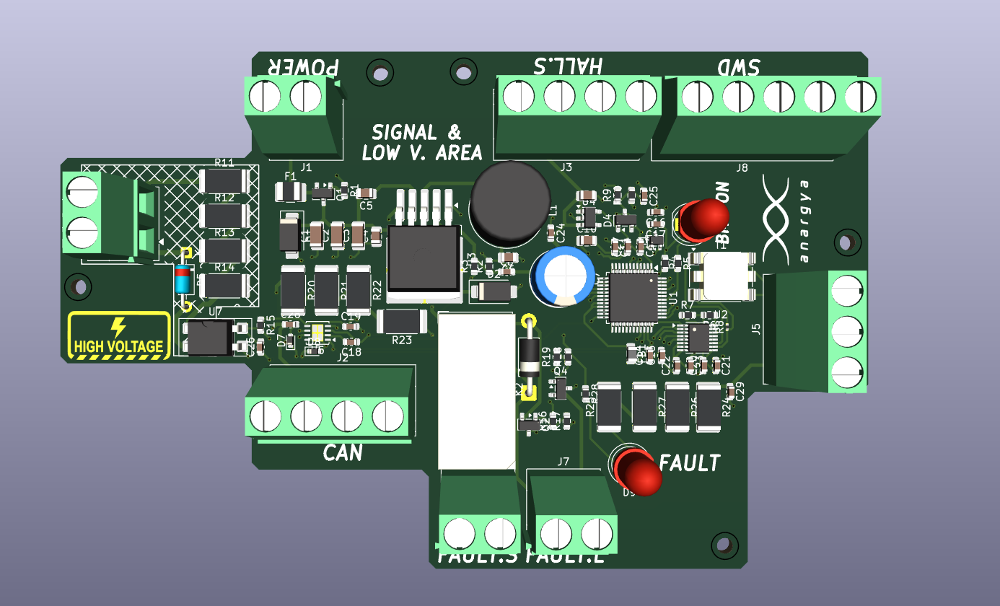
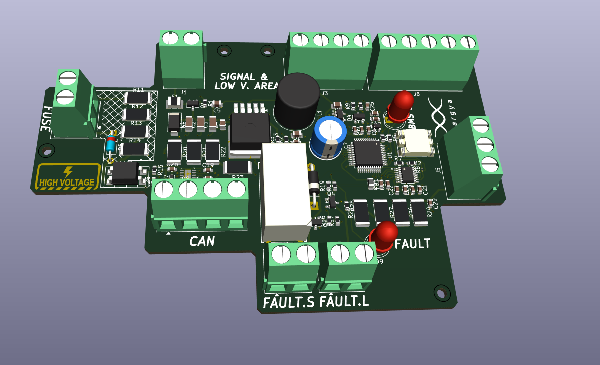
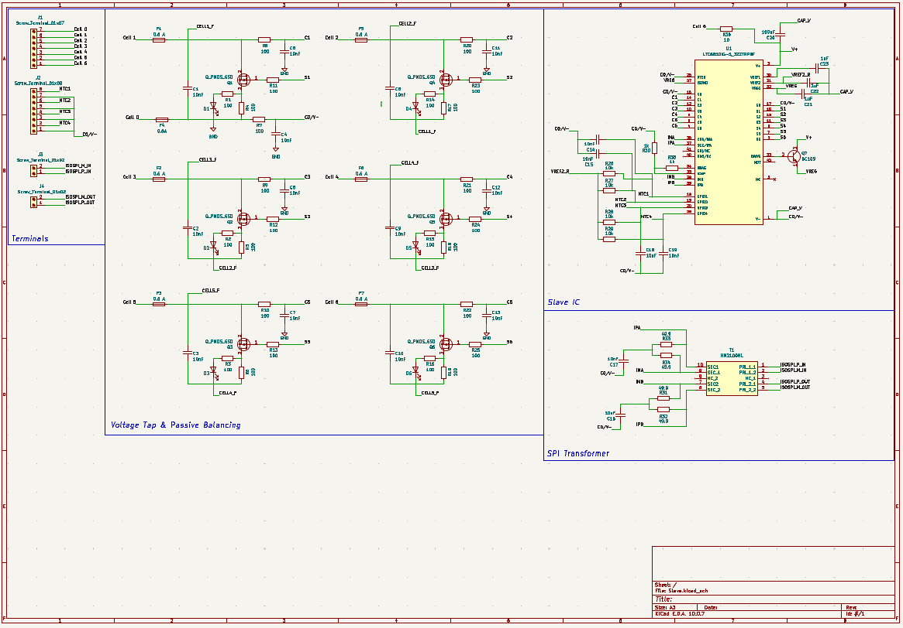
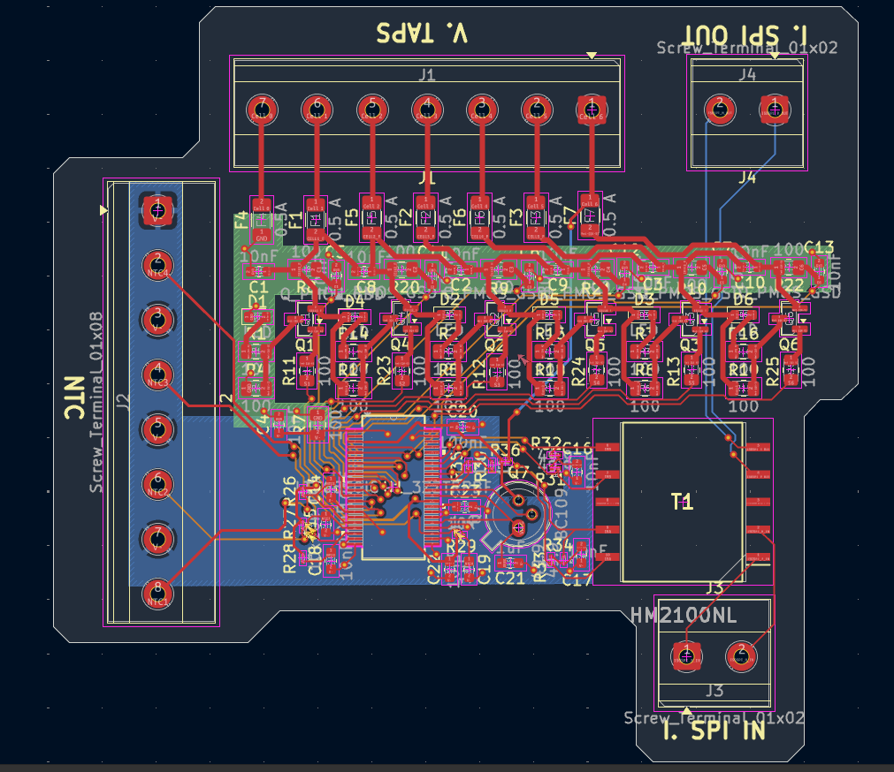
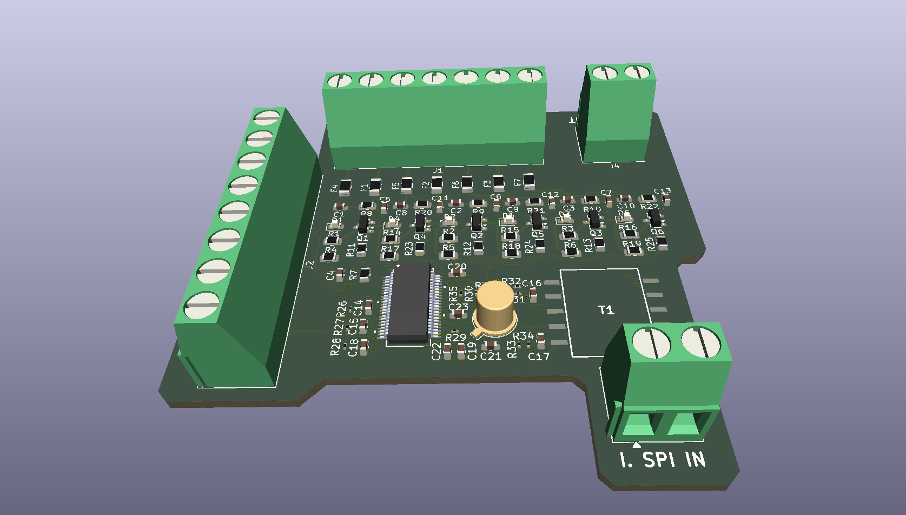
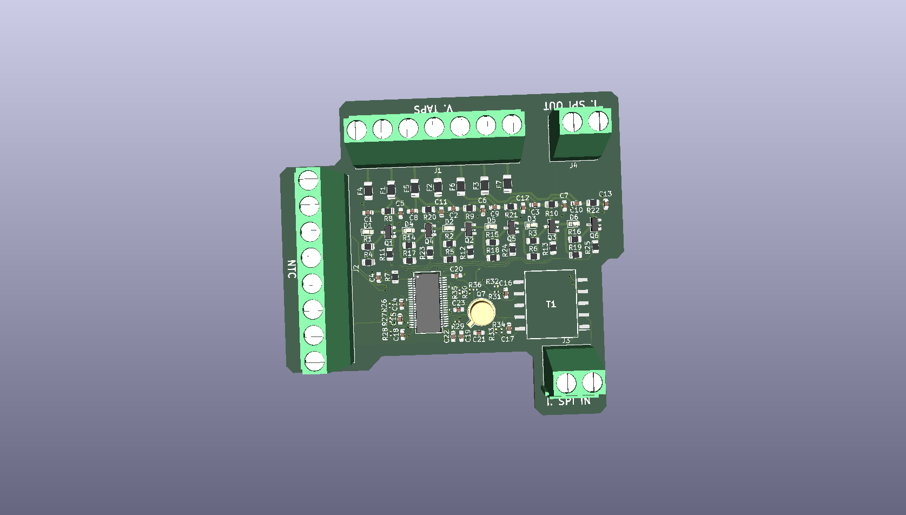

# Master-Slave Battery Management System
### STM32G4 Master Controller · LTC6810 Slave Monitoring

A distributed Battery Management System (BMS) designed for a **102S2P electric vehicle battery pack**, featuring an STM32G4-based master controller and LTC6810-based slave monitoring units.

The system implements a modular master-slave architecture with **isoSPI daisy-chain communication**, enabling distributed battery cell voltage monitoring, temperature monitoring, centralized fault detection, and telemetry.

---

## Table of Contents

- [Overview](#overview)
- [Battery Pack Configuration](#battery-pack-configuration)
- [System Architecture](#system-architecture)
- [Monitoring Capabilities](#monitoring-capabilities)
- [Hardware Design](#hardware-design)
  - [Master BMS](#1-master-bms--stm32g4)
  - [Slave BMS](#2-slave-bms--ltc6810)
- [Communication Architecture](#communication-architecture)
- [Repository Structure](#repository-structure)
- [Development Tools](#development-tools)
- [Project Status](#project-status)
- [Future Improvements](#future-improvements)
- [Disclaimer](#disclaimer)

---

## Overview

The Battery Management System is responsible for monitoring and managing battery operating conditions to support safe and reliable electric vehicle operation.

This project implements a distributed monitoring architecture consisting of two primary subsystems:

- **Master BMS:** An STM32G4-based controller responsible for centralized system supervision, data acquisition, fault detection, and telemetry management.
- **Slave BMS:** LTC6810-based monitoring units responsible for individual battery module voltage and temperature monitoring.

The architecture separates module-level battery monitoring from high-level system management, allowing the battery pack to be monitored through interconnected slave units coordinated by a central master controller.

The hardware and PCB designs were developed using KiCad, with dedicated circuits for master control, battery monitoring, and inter-board communication.

## Battery Pack Configuration

The BMS is designed to support a **102S2P battery pack**, organized into 17 battery modules connected in series.

Each module consists of 6 series-connected cell groups, with each group containing 2 cells connected in parallel (6S2P per module).

This configuration results in 102 series-connected cell groups across the complete battery pack.

| Parameter | Specification |
|---|---|
| Battery Configuration | 102S2P |
| Total Battery Modules | 17 |
| Configuration per Module | 6S2P |
| Series Voltage Taps per Module | 6 |
| Temperature Sensors per Module | Up to 4 NTC thermistors |
| Total Voltage Monitoring Points | 102 |
| Maximum Temperature Monitoring Points | 68 |

### Battery Monitoring Distribution

Each module is equipped with local monitoring capabilities:

| Monitoring Parameter | Per Module | Entire Battery Pack |
|---|---:|---:|
| Cell Group Voltage | 6 channels | 102 channels |
| NTC Temperature | Up to 4 channels | Up to 68 channels |

This modular configuration enables the system to collect battery operating data across all 17 modules while maintaining centralized supervision.

### Main Subsystems

| Subsystem | Main Component | Responsibility |
|---|---|---|
| Master Controller | STM32G4 | Centralized control and system supervision |
| Slave Monitoring | LTC6810 | Battery cell voltage and temperature monitoring |
| Inter-board Communication | isoSPI | Isolated serial communication through a daisy-chain topology |
| Temperature Sensing | NTC Thermistors | Battery module temperature measurement |
| Data Management | STM32G4 | Monitoring data processing and telemetry |
| Fault Management | STM32G4 | Centralized fault detection and system response |

## Monitoring Capabilities

### 1. Cell Voltage Monitoring

Each slave monitoring unit uses the LTC6810 battery monitoring IC to measure six series-connected cell-group voltages within its respective battery module.

Features:
- Individual cell-group voltage measurement.
- Monitoring of all 102 series-connected cell groups.
- Distributed voltage acquisition across 17 battery modules.
- Centralized monitoring data collection.

### 2. Temperature Monitoring

Each battery module supports up to four NTC thermistors for temperature measurement.

Features:
- Up to four temperature sensing channels per module.
- Maximum of 68 temperature monitoring points across the battery pack.
- Temperature data acquisition through the slave monitoring units.
- Centralized temperature monitoring and fault evaluation.

### 3. Fault Detection

The master controller processes monitoring data received from the slave units to evaluate battery operating conditions.

The architecture supports centralized evaluation of voltage and temperature measurements to identify abnormal battery conditions.

### 4. Telemetry

The master controller manages battery monitoring data and provides a centralized interface for system-level telemetry.

Monitoring information can be collected and processed for external system integration and battery status visualization.

## Hardware Design

The hardware consists of two primary PCB designs: the Master BMS and Slave BMS.

All schematics and PCB layouts were developed using KiCad.

---

### 1. Master BMS | STM32G4

Master BMS hardware overview

**Main Controller:** STM32G4

**Primary Responsibilities:**
- Centralized BMS control and supervision.
- Communication with LTC6810 slave monitoring units.
- Monitoring data acquisition and processing.
- Battery voltage and temperature data management.
- Fault detection and system-level monitoring.
- Telemetry management.

#### Schematic

#### PCB Layout

#### PCB 3D View

---

### 2. Slave BMS | LTC6810

Slave BMS hardware overview

**Battery Monitoring IC:** LTC6810

**Primary Responsibilities:**
- Monitoring six series-connected cell-group voltages per module.
- Acquiring temperature measurements from up to four NTC thermistors per module.
- Communicating monitoring data through the isoSPI interface.
- Supporting distributed battery monitoring across 17 modules.

#### Schematic

#### PCB Layout

#### PCB 3D View

---

## Communication Architecture

The system uses **isoSPI communication** to establish communication between the STM32G4 master controller and the LTC6810 slave monitoring ICs.

The LTC6810 devices are interconnected through an **isoSPI daisy-chain topology**, allowing monitoring data to be transferred across multiple slave units through a serial communication chain.

### Communication Structure

- **Master Interface:** STM32G4 communicates with the first LTC6810 through an SPI-to-isoSPI interface.
- **Slave Communication:** LTC6810 devices communicate through their isoSPI interfaces.
- **Topology:** Daisy-chain configuration connecting the monitoring ICs.
- **Data Acquisition:** The master controller coordinates communication and collects battery monitoring information from the slave units.

### Communication Advantages

- Differential communication over twisted-pair connections.
- Galvanically isolated communication between battery monitoring circuits and the master interface when implemented with the appropriate isolation coupling components.
- Reduced wiring complexity compared with individual communication connections to every monitoring unit.
- Scalable communication architecture for distributed battery monitoring.

## Development Tools

| Tool / Component | Purpose |
|---|---|
| KiCad | Schematic capture and PCB design |
| STM32G4 | Master microcontroller |
| LTC6810 | Battery cell monitoring IC |
| isoSPI | Isolated serial communication interface |
| NTC Thermistors | Temperature sensing |
| Embedded C/C++ | Firmware development |

## Project Status

The hardware and firmware development have been completed, with further refinement and validation remaining.

| Development Area | Status |
|---|---|
| System Architecture | Completed |
| Master BMS Hardware | Completed |
| Slave BMS Hardware | Completed |
| PCB Design | Completed |
| Master Firmware | Developed |
| Slave Firmware | Developed |
| Communication Implementation | Developed |
| Documentation | Ongoing |
| Design Refinement & Validation | Ongoing |

## Future Improvements

- Further refinement of schematic and PCB designs.
- Additional communication reliability testing.
- Expanded battery fault detection and protection mechanisms.
- Improved telemetry and monitoring capabilities.
- Further validation of voltage and temperature measurement accuracy.
- System-level integration and testing.

## Disclaimer

This project is an engineering development project intended for educational and electric vehicle research purposes.

The documented design should not be considered a production-ready battery protection system without appropriate electrical, functional, and safety validation.

High-voltage battery systems require proper insulation, isolation, protection mechanisms, and qualified engineering supervision before physical implementation.

---

**Developed for electric vehicle battery management and high-voltage electrical system applications.**
